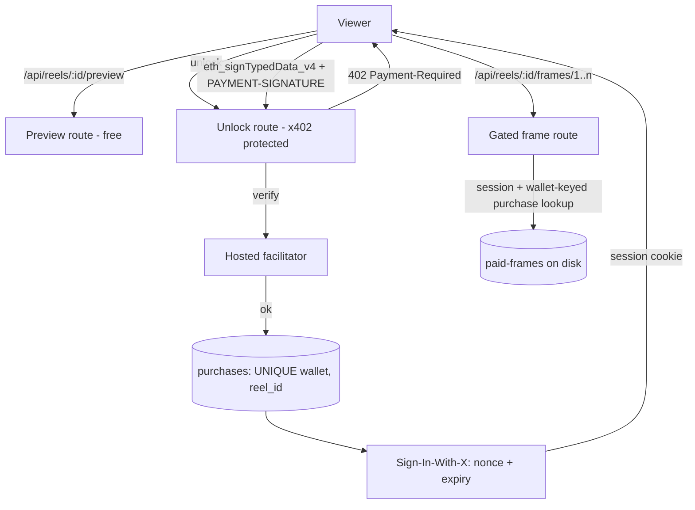

# The Bioscope (P3)

A hand-cranked film viewer with a paywall. Every reel shows you **its first frame
for nothing**. The rest of the reel costs one small x402 payment, once, and then it
is yours to watch for as long as your sign-in lasts.

The interesting part is not that it takes payment. It is that **you never pay
twice, and the server is the only thing that decides anything.**

```bash
npm install
npm start
```

Then open **http://localhost:8787** and click **Unlock** on a reel. That is the
whole demo. `Ctrl-C` stops the server.

**Where to read next.**
[`ARCHITECTURE.md`](./ARCHITECTURE.md) is the four load-bearing decisions and why
each is a property of the control flow rather than a promise.
[`P3_PLAN.md`](./P3_PLAN.md) is the task-by-task record: what was verified, how it
was verified, and what is still unverified.

---

## Read this first: what "paid" means here

**By default, no money moves anywhere in this repository.** Not in the demo, not in
the tests, not in the seed script.

`BIOSCOPE_PAYMENT_MODE` defaults to `simulated`, and in that mode the facilitator
is a local stand-in (`src/payment/simulated-facilitator.ts`) that:

- contacts no chain and verifies no signature;
- still **refuses** a payment whose amount, asset, network or recipient disagrees
  with what the server advertised, or that carries no identifiable payer — a stub
  that accepted anything would let a test pass against a server a real client could
  not pay;
- returns a transaction hash that is a SHA-256 of your payment, prefixed with a
  zero word, so it has the *shape* of a hash and resolves on no block explorer.

The page says this in plain words above the fold, every response carries
`X-Bioscope-Settlement-Mode: simulated`, and the receipt after an unlock says
"Simulated payment recorded. No chain was contacted and no funds moved."

What **is** real in simulated mode: the x402 V2 protocol (the 402, the
`PAYMENT-REQUIRED` / `PAYMENT-SIGNATURE` / `PAYMENT-RESPONSE` headers, the
`exact`/EIP-3009 scheme, the settle lifecycle), the Sign-In-With-X challenge and
its verification (a real secp256k1 signature recovered by viem, with no
substitutable verifier anywhere in the codebase), the SQLite purchase and session
ledgers, and every access decision.

Real testnet settlement on Ethereum Sepolia is wired and configuration-checked, and
**has never been run.** See [Limitations](#limitations).

---

## Requirements

| | |
|---|---|
| Node | **22.5.0 or newer.** SQLite is the `node:sqlite` builtin, so there is no native build step. Developed and verified on 22.22.0. |
| A browser wallet | Only to *unlock* a reel. Browsing and the free preview need nothing. Any EIP-1193 wallet (MetaMask, Rabby) on `localhost`. |
| Credentials | **None.** There is no key to obtain for the demo, the tests, or the seed. |

## Commands

| Command | What it does |
|---|---|
| `npm start` | Runs the server. Seeds the frames first if they are missing. |
| `npm run dev` | The same, restarting on change. |
| `npm run seed` | Draws the 24 placeholder frames and prints a report. Optional — `npm start` does it for you — but it is the one command that tells you the frames exist. |
| `npm test` | The whole suite: 20 files, 293 tests, no network, no wallet, no chain. |
| `npm run verify` | **The one to run before believing anything here.** Typecheck → browser-JS check → credential scan → tests. |
| `npm run scan:credentials` | Credential scan on its own, across P3, P1, P2 and `docs/`. |

`npm run verify` is deterministic: no live testnet calls, no wallet, no browser, no
network. It is the command a reviewer should run, and it is the command the T8
report quotes.

### About the frames

The frames are **generated SVGs**, drawn from each reel's metadata by
`npm run seed` — a seeded skyline, a sun that crosses the frame as the reel plays,
sprocket holes, the caption, and a `FREE PEEK` / `PAID FRAME` badge. There is no
external asset of any kind, so the demo works with the machine unplugged and the
seed is byte-for-byte reproducible.

They are deliberate geometric placeholders, not photographs. The problem statement
allows images you made yourself; a binary blob would have been worse for anyone
reviewing whether paid media is reachable.

---

## Configuration

Copy `.env.example` to `.env` (which is git-ignored). **Nothing in it is required**
for the demo, the tests, or the seed.

| Variable | Default | What it does |
|---|---|---|
| `BIOSCOPE_PAYMENT_MODE` | `simulated` | `simulated` or `testnet`. Read by the server; a client cannot talk it up to "real". |
| `PORT` | `8787` | Listener port. |
| `BIOSCOPE_ORIGIN` | `http://localhost:8787` | **The browser's origin.** Sign-In-With-X binds every challenge to this, and the server refuses a challenge whose domain or URI does not match. |
| `BIOSCOPE_REEL_PRICE_ATOMIC` | `1000` | Price per reel in USDC base units. 6 decimals, so `1000` is `0.001 USDC`. Integer only — no floating point anywhere near money. |
| `BIOSCOPE_RECIPIENT_ADDRESS` | *(empty)* | Where the coins go. Required in `testnet` mode. |
| `BIOSCOPE_DB_PATH` | `./data/bioscope.db` | The SQLite file holding purchases, spent nonces and sessions. |
| `BIOSCOPE_STORAGE_DIR` | `./storage` | Frame store root. `public-frames/` is a **directory name, not a web root**. |
| `BIOSCOPE_FACILITATOR_URL` | *(empty)* | Required in `testnet` mode. |
| `BIOSCOPE_PAYER_PRIVATE_KEY` | *(empty)* | Read and shape-checked so a missing key is reported at startup. The server does not need it and does not use it — the x402 client signs the payment, the facilitator verifies it. |
| `BIOSCOPE_SIWX_EXPIRATION_SECONDS` | `300` | Challenge lifetime. 30–3600; refused at boot otherwise. |
| `BIOSCOPE_SESSION_TTL_SECONDS` | `900` | Session lifetime. 60–86400; refused at boot otherwise. |

A bad configuration is **one error listing every problem**, before the port is
bound. A server that starts into a broken environment is how a demo ends up
charging in `simulated` mode while everyone believes it settled for real.

### The origin rule, which is the one that bites

Open the page at the **exact** origin in `BIOSCOPE_ORIGIN`. With the defaults that
means `http://localhost:8787` — not `http://127.0.0.1:8787`, and not port 8788.

The SIWX challenge carries `domain: localhost:8787`, and the server compares it to
the configured origin's host. A mismatch is refused as `invalid_siwx_domain_mismatch`,
which surfaces in the page as *"Sign-in was refused (challenge-rejected)"*. If you
change the port, change `BIOSCOPE_ORIGIN` with it.

---

## The wallet flow, and what to expect

Unlocking asks your wallet for **exactly two signatures**, and nothing else:

1. **An EIP-712 signature** authorising the payment. This is the EIP-3009
   `TransferWithAuthorization` for `0.001 USDC` on Ethereum Sepolia, signed over the
   domain, amount, recipient and a fresh nonce that the server generated. In
   `testnet` mode this is what authorises a real transfer of test USDC.
2. **A `personal_sign`** of the sign-in challenge — an EIP-4361 message naming the
   origin, the wallet, and an expiry. It costs nothing and moves nothing. It is
   exchanged for a session cookie so the other seven frames do not each need their
   own signature.

Then the reel plays. **Reload the page and the second button says "Watch it": no
prompt at all**, because the session cookie is still valid and the server still has
your purchase in SQLite.

If your wallet is on another chain, the page asks it to switch to Ethereum Sepolia and
refuses clearly if it cannot. If there is no wallet at all, the page says so and
leaves the reel locked — which is the correct outcome, not a fallback.

The session is an `HttpOnly` cookie: the page cannot read it, `localStorage` is
never touched, and there is no control anywhere that could change a price, a
network, a wallet or an entitlement. Signing out revokes the session server-side.

---

## What is where

```
p3-bioscope/
  public/            the browser UI: three files, no build step
  src/
    config.ts        every environment read, validated once
    domain/          reels, entitlement, money, wallet identity, sessions
    media/           the frame store - the private-frame boundary lives here
    payment/         x402 routes, the SIWX extension, the simulated facilitator
    http/            the page, the catalog, the gate, the session routes
    db/              SQLite: purchases, spent nonces, sessions
  storage/
    public-frames/   the FREE frame of each reel. A directory name, not a web root.
    paid-frames/     every other frame. Read only by the gated handler.
  tests/             293 tests over 20 files
```

The rule that shapes the whole server: **there is no `express.static` anywhere.**
Every frame, free or paid, comes out of the media store through a route handler,
and the store refuses to hand out a paid frame to anything but the gate. Paid
frames have no URL to guess at, and a mistake gets a 404 rather than a leak.

---

## Limitations

Stated plainly, because a demo that overstates itself is the one thing this project
is trying not to be.

- **Live testnet settlement is unverified.** `BIOSCOPE_PAYMENT_MODE=testnet` is
  wired, config-validated and refused-at-boot-if-incomplete, but it has never been
  run against a real facilitator or a funded key. Everything above about testnet is
  a claim about the code, not a report of an outcome.
- **The page has never been opened in a browser by the author.** The payment and
  sign-in logic is verified by driving the real client module against a real server
  over a real socket with real signatures. The *rendering* — layout, focus order,
  the wallet dialog, the playback animation — is verified only by reading it. T9 is
  the browser pass.
- **EOA wallets only.** Signatures are recovered with viem's `verifyMessage`, which
  is EIP-191 for an externally owned account. A smart-contract wallet (EIP-1271)
  would need an RPC-backed verifier, which this project deliberately does not have.
- **The frames are placeholders.** Geometric SVGs, not photographs.
- **One route.** There is no per-reel URL, so a reel cannot be linked to or
  bookmarked.
- **Paid-frame captions exist only inside the image.** The catalog does not carry
  them, deliberately — putting a reel's captions in a publicly cacheable response
  would give the reel away before anyone pays — so a screen-reader user gets the
  reel title and the frame position rather than the caption.
- **A stolen session cookie works** from anywhere on the right origin until it
  expires. That is the same trust model as the signature it replaces, and the
  lifetime is 15 minutes by default.
- **No rate limiting** on the session endpoint.
- **The DOM half of the UI is untested by the suite.** A DOM emulator would test the
  emulator, so the checks are static: the shell renders every element the app looks
  up, and the app uses no web storage and never reads the cookie.

---

## Credentials you may need later, and when

**None for anything in this repository today.** The demo, the tests, the seed and
the credential scan all run with no key, no `.env`, and no network.

Only live testnet settlement needs input from you, and only if you want to run it:

| Variable | Purpose |
|---|---|
| `BIOSCOPE_PAYMENT_MODE=testnet` | Switch the server from the simulated facilitator to a real one. |
| `BIOSCOPE_RECIPIENT_ADDRESS` | Your Ethereum Sepolia address — where test USDC would go. |
| `BIOSCOPE_FACILITATOR_URL` | An x402 facilitator that settles `eip155:11155111`. |
| `BIOSCOPE_PAYER_PRIVATE_KEY` | A **test-only** Ethereum Sepolia key holding test USDC. The server does not use it; a paying *client* needs one. |

Use a key that holds test USDC and nothing else. `.env` is git-ignored, and
`npm run scan:credentials` reads a real `.env` if one exists so that a leak is
caught rather than assumed absent.

## Architecture



Frame 0 is served free from `public-frames`. Frames 1..n live in `paid-frames`,
which no static mount serves, and are reachable only through the gated handler.

## Verified status

Run locally on this machine. Numbers are what the commands printed.

| Command | Result |
|---|---|
| `npm run typecheck` | exit 0 |
| `npm run check:browser-js` | exit 0 |
| `npm run scan:credentials` | **PASS**, 184 files, 0 findings |
| `npm test` | **293 / 293 passing**, 20 files |

A migrated server was started in simulated mode and checked over HTTP:

```
GET /api/reels/calcutta-tram/preview              -> 200   (free first frame)
GET /api/reels/calcutta-tram/frames/frame-001.svg -> 402   (gated)
banner: "Simulated mode ... recorded only in this app's local database"
        and it names no chain
```

**No live payment has been made. There is no transaction hash, and none is
claimed.**

## Environment

Copy `.env.example` to `.env`. `.env` is gitignored. Do not commit it.
**No `.env` is needed for the simulated demo at all.**

| Variable | Required | Purpose | Value |
|---|---|---|---|
| `BIOSCOPE_PAYMENT_MODE` | no | `simulated` (default) or `testnet` | leave blank |
| `BIOSCOPE_RECIPIENT_ADDRESS` | only for `testnet` | Public recipient for real test USDC. Not a secret. | `0x` + 40 hex - **you supply** |
| `BIOSCOPE_FACILITATOR_URL` | only for `testnet` | Must settle `eip155:11155111` | leave blank |
| `BIOSCOPE_ORIGIN` | no | Must be the exact origin you open. Defaults to `http://localhost:8787` | leave blank |
| `PORT` | no | Defaults to `8787` | leave blank |
| `BIOSCOPE_REEL_PRICE_ATOMIC` | no | Defaults to `1000` base units (0.001 USDC, 6 decimals) | leave blank |
| `BIOSCOPE_PAYER_PRIVATE_KEY` | no | **Leave blank.** The server never signs; MetaMask is the payer. | leave blank |

## Local simulation vs live Sepolia

- **Simulated (default, no credentials).** The wallet signatures are real
  cryptography and the server verifies both, but **no chain is contacted and no
  funds move**. The purchase is recorded only in this app's local SQLite
  database, and the receipt carries a fingerprint, not a transaction hash. The
  mode band above the fold says so.
- **Testnet (`BIOSCOPE_PAYMENT_MODE=testnet`).** Wired and configuration-checked
  against Ethereum Sepolia. **Never run.** Unverified.

## Known gaps

1. **Live settlement is unverified.** `testnet` mode has never been executed
   against a live facilitator, so there is no transaction hash to show.
2. **The browser client hand-rolls the x402 payload** - it imports nothing from
   `@x402/*` and encodes the payment itself, so there is no build step. That also
   means the wire format is not checked against the SDK at compile time, and the
   first real payment is the first execution of that encoder. Expect this to be
   where a first attempt fails.
3. The SDK has no default asset for `eip155:11155111` -
   `getDefaultAsset` **throws** for it - so the asset, decimals and EIP-712
   domain are declared in `src/config.ts` from values read off the token
   contract, and the startup check validates shape and decimals instead of
   comparing against the SDK table.
4. No browser testing was performed by the author of these changes.
